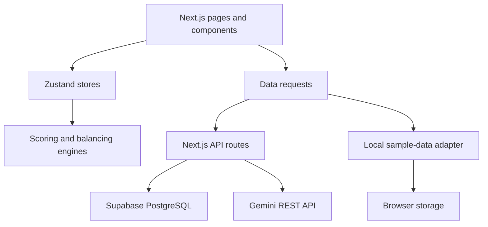

# Gully Cricket

A cricket scoring and squad management app for neighbourhood matches. Manage players, create balanced teams, configure local rules, score deliveries, and review results. Gemini adds team reviews, personalised practice plans, and post-match analysis.

The app runs with browser-local sample data or a shared Supabase database. Gemini requests always run on the server with a real API key.

## Features

- Player profiles with roles, skill ratings, career totals, and form indicators.
- Team generation using a greedy assignment and local-search algorithm, with manual swaps and support for a common player.
- Configurable overs, ball type, retirement options, and gully rules such as roof catches and one-tip-one-hand catches.
- Live scoring with extras, wickets, strike rotation, innings changes, and undo.
- Match summaries with player-of-the-match calculations and scoring charts.
- Leaderboards for runs, wickets, strike rate, and economy.
- Gemini team reviews with optional, validated player swaps.
- Gemini coaching plans based on a player's stats, chosen focus, and goal.
- Gemini match analysis based on recorded scores and over summaries.

## Tech stack

| Area | Technology |
| --- | --- |
| Application | Next.js 14 App Router, React 18, TypeScript |
| Styling | Tailwind CSS, custom CSS |
| State | Zustand; browser storage for persisted state |
| Animation and charts | Framer Motion, Recharts |
| UI utilities | Lucide icons, Sonner notifications, canvas-confetti |
| Server endpoints | Next.js route handlers |
| Database | Supabase PostgreSQL |
| Optional sign-in | Supabase Auth |
| AI | Gemini REST API with structured JSON output |
| Validation | Zod |
| Tests | Node.js test runner |
| Hosting configuration | Vercel |

## Run locally

### Requirements

- Node.js 20 or newer; Node.js 22 is recommended.
- npm and a local checkout of this repository.
- A Gemini API key to use the AI features.
- A Supabase project only if you want database-backed storage.

### 1. Install dependencies

Run these commands from the repository root:

```sh
npm ci
```

### 2. Create your environment file

On macOS, Linux, or WSL:

```sh
cp .env.local.example .env.local
```

On Windows PowerShell:

```powershell
Copy-Item .env.local.example .env.local
```

For a local run without a database, use:

```dotenv
NEXT_PUBLIC_DEMO_MODE=true
GEMINI_API_KEY=your-gemini-api-key
GEMINI_MODEL=gemini-3-flash-preview
NEXT_PUBLIC_APP_URL=http://localhost:3000
```

This loads 12 fictional players, two teams, three completed matches, and a live chase. Cricket data changes stay in the browser under separate sample-data storage keys. They do not write to Supabase. AI requests are not mocked: they still go to Gemini. Without a Gemini key, the regular cricket features work and the AI panels show a disconnected state.

### 3. Start the app

```sh
npm run dev
```

Open [http://localhost:3000](http://localhost:3000).

Restart the development server after changing environment variables. Variables prefixed with `NEXT_PUBLIC_` are bundled into the browser application; changes also require a rebuild for a production deployment.

## Environment variables

| Variable | Purpose | Required |
| --- | --- | --- |
| `NEXT_PUBLIC_DEMO_MODE` | `true` uses browser-local sample data; `false` uses Supabase | Set explicitly for the intended mode |
| `GEMINI_API_KEY` | Server-side Gemini credential | For AI features |
| `GEMINI_MODEL` | Gemini text model with structured-output support | Optional; defaults to `gemini-3-flash-preview` |
| `NEXT_PUBLIC_SUPABASE_URL` | Supabase project URL | Database mode |
| `NEXT_PUBLIC_SUPABASE_PUBLISHABLE_KEY` | Supabase public publishable key | Database mode; alternatively use the anon key |
| `NEXT_PUBLIC_SUPABASE_ANON_KEY` | Legacy public anon key, used when no publishable key is set | Alternative to the publishable key |
| `SUPABASE_SERVICE_ROLE_KEY` | Server-side credential used by data endpoints | Database mode |
| `NEXT_PUBLIC_APP_URL` | Application origin used for sign-up confirmation redirects | When using sign-in/sign-up |

Keep `GEMINI_API_KEY` and `SUPABASE_SERVICE_ROLE_KEY` server-side. Do not prefix either with `NEXT_PUBLIC_`. Local environment files are ignored by Git; the example file contains placeholders only.

## Set up Supabase

1. Create a Supabase project and copy its project URL, public publishable or anon key, and service-role key into `.env.local`.
2. Review and run [supabase/schema.sql](supabase/schema.sql) in the project's SQL Editor.
3. Set `NEXT_PUBLIC_DEMO_MODE=false` and restart the app.

**The schema is a reset script. It drops existing cricket tables and recreates them. Use a new or disposable database, or back up existing data before running it.** It also inserts an initial player roster. The app's players endpoint seeds that roster again if the database contains no players.

The schema defines:

| Object | Purpose |
| --- | --- |
| `players` | Profiles, skill ratings, and career totals |
| `matches` | Match metadata and a JSONB match-state snapshot |
| `balls` | Schema for individual deliveries |
| `player_stats` | Schema for per-player, per-match statistics |
| `player_analytics` | SQL view used by the leaderboard endpoint |

The current sync endpoint stores match snapshots and updates player career totals. It does not populate every schema table or provide a complete analytics ingestion pipeline.

## Use the app

1. Open **The squad** to add or edit players and their skill ratings.
2. Open **Match centre**, select available players, and generate teams.
3. Review the team metrics, swap players if needed, or request a Gemini team review. Suggested swaps require your action and are validated before applying.
4. Configure the match rules, complete the toss, and select the opening batters and bowler.
5. Record deliveries on the live scoring screen. Use undo to correct the latest delivery.
6. After the match, review the scorecard and charts or request Gemini match analysis.
7. Open a player profile to choose a practice focus and request a coaching plan.

## Architecture



### Cricket logic and state

`scoring/engine.ts` handles score calculations, run rates, overs, and match helpers. `balancing/engine.ts` generates teams from skill ratings and recorded performance; this algorithm works without an LLM. `commentary/generator.ts` produces template-based delivery commentary.

Zustand stores hold the live match, player roster, settings, and match setup. Match, player, and settings state persist in browser storage; team setup is temporary. The live scoring page attempts match synchronisation every 30 seconds, and the summary page also requests a sync.

In local sample-data mode, `DemoProvider` intercepts supported browser cricket-data requests and handles them through the local adapter. The server's database endpoints are unchanged. Requests to `/api/ai/*` always reach the server.

### Gemini integration

The browser builds a limited cricket context and sends it to a Next.js route. The server validates it with Zod, calls Gemini with a JSON response schema, and validates the result again before returning it. It forwards selected cricket fields rather than full account or store records.

Reports are generated on demand and kept in component memory. Changing the input discards stale results and cancels the current client request. Suggested team swaps cannot reference unknown players or move a shared common player; applying a swap recalculates the team metrics.

AI endpoints enforce a 96 KB request-body limit, a 25-second provider timeout, and process-local rate limits. The key is never sent to the browser.

## Repository layout

| Path | Contents |
| --- | --- |
| `app/` | Pages, layouts, global styles, and API route handlers |
| `components/` | Navigation, player cards, scoring dialogs, charts, and AI panels |
| `providers/` | Theme setup and local sample-data integration |
| `store/` | Zustand match, player, settings, and setup state |
| `scoring/` | Match and delivery calculations |
| `balancing/` | Team generation, swaps, and strength calculations |
| `commentary/` | Delivery commentary templates |
| `lib/ai/` | Gemini client, context builders, and validation contracts |
| `lib/demo/` | Optional local data fixtures and request adapter |
| `supabase/` | Browser/server clients and database schema |
| `types/` | Shared cricket and application types |
| `tests/` | Automated AI, validation, and local-data tests |
| `public/` | Static application metadata |

## API routes

| Route | Methods | Purpose |
| --- | --- | --- |
| `/api/players` | GET, POST | List or create players |
| `/api/players/[id]` | GET, PATCH, DELETE | Read, edit, or delete a player |
| `/api/teams/generate` | POST | Generate balanced teams |
| `/api/matches` | GET, POST, DELETE | List, create, or clear matches |
| `/api/matches/[id]` | DELETE | Delete a match |
| `/api/matches/sync` | POST | Save a match snapshot and update completed-match career totals |
| `/api/stats` | GET | Read leaderboard data |
| `/api/ai/status` | GET | Check whether Gemini is configured |
| `/api/ai/teams` | POST | Review teams and suggest an optional swap |
| `/api/ai/match` | POST | Analyse a match |
| `/api/ai/coach` | POST | Generate a practice plan |
| `/api/auth/callback` | GET | Complete a Supabase sign-in callback |

## Development commands

| Command | Purpose |
| --- | --- |
| `npm run dev` | Start the development server |
| `npm run build` | Create the production build |
| `npm start` | Serve an existing production build |
| `npm test` | Run automated tests without a real key or database |
| `npm run test:ai` | Alias for the same test suite |
| `npm run typecheck` | Check TypeScript types |
| `npm run lint` | Run the Next.js ESLint checks |

Tests exercise the actual validation, Gemini client, route handlers, context builders, swap logic, and local-data adapter. Gemini HTTP requests and the Next.js response adapter are mocked. These checks do not replace live browser, database, or provider integration testing.

## Deployment

The repository includes Vercel configuration. Import the repository, configure the environment variables for the intended storage mode, and use `npm run build` as the build command. For another Node.js host, build with `npm run build` and serve with `npm start`.

Local sample data lives in each visitor's browser; it is not a shared database. Use Supabase mode when players and matches need shared persistence.

## Current limits

- Data endpoints use a server-side service-role client for a shared club dataset. The optional login page does not enforce user isolation or protect those endpoints. Add authorisation before opening the app to untrusted users.
- AI rate limits are in memory per server process. They are not shared across instances or retained after restarts.
- Match synchronisation and aggregate statistics are not a transactional, idempotent pipeline. Database analytics and repeated completed-match syncs need further validation before production use.
- Browser persistence restores local state, but there is no service-worker cache or complete offline sync queue. The web manifest alone does not provide full offline/PWA support.

## Troubleshooting

| Symptom | Check |
| --- | --- |
| `next` is not recognised | Run `npm ci` in the repository root |
| Sample players appear instead of the database roster | Set `NEXT_PUBLIC_DEMO_MODE=false`, configure Supabase, and restart |
| Gemini is disconnected | Set the server-side `GEMINI_API_KEY` and restart |
| Gemini rejects the model or returns a quota error | Choose a model accessible to the key, or check the project's provider quota |
| Player or match requests fail in database mode | Check the Supabase URL, public key, service-role key, and schema |
| Leaderboard totals are empty in database mode | Check whether `player_stats` is populated; the view aggregates that table |
| Sign-in confirmation redirects incorrectly | Set `NEXT_PUBLIC_APP_URL` to the app's origin |
