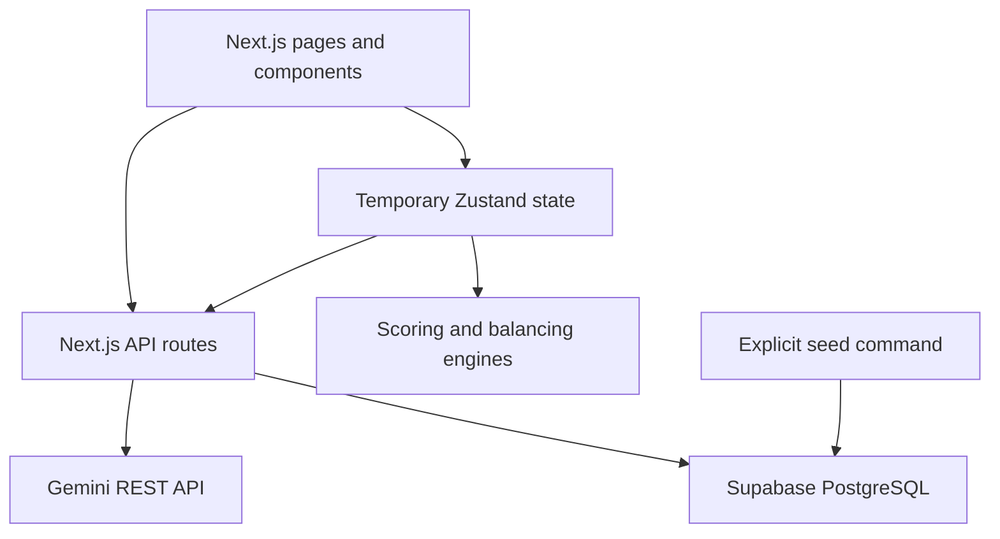

# Gully Cricket

A cricket scoring and squad management app for neighbourhood matches. Create players, generate balanced teams, configure local rules, score deliveries, and review results. Gemini adds team reviews, coaching plans, and match analysis.

**Supabase is the only persistent data source.** Players, matches, statistics, and club settings are shared across devices. Zustand holds temporary UI state; cricket data is never saved to browser local storage. Fictional data is inserted explicitly into Supabase with the seed command.

## Features

- Player profiles, skill ratings, career totals, and leaderboards.
- Balanced teams with manual swaps and support for a common player.
- Configurable overs, retirement rules, roof catches, and one-tip-one-hand catches.
- Ball-by-ball scoring, extras, wickets, strike rotation, innings changes, and undo.
- Database-backed match recovery and historical scorecards.
- Gemini team reviews with validated optional swaps, player coaching, and match analysis.

## Tech stack

| Area | Technology |
| --- | --- |
| Application | Next.js 14 App Router, React 18, TypeScript |
| UI | Tailwind CSS, Framer Motion, Lucide, Sonner |
| Charts | Recharts |
| Temporary state | Zustand, React state |
| Persistent storage | Supabase PostgreSQL |
| Optional authentication | Supabase Auth |
| AI | Gemini REST API, structured JSON responses |
| Validation | Zod |
| Tests | Node.js test runner |
| Deployment | Vercel |

## Setup

Use Node.js 20 or newer and npm. Run commands from the repository root.

```sh
npm ci
```

Copy `.env.local.example` to `.env.local`:

```powershell
# Windows PowerShell
Copy-Item .env.local.example .env.local
```

```sh
# macOS / Linux
cp .env.local.example .env.local
```

Fill in the following configuration. Environment files and dependencies are ignored by Git.

| Variable | Purpose |
| --- | --- |
| `NEXT_PUBLIC_SUPABASE_URL` | Required: Supabase project URL |
| `SUPABASE_SERVICE_ROLE_KEY` | Required: server-side service-role key for database endpoints and seeding |
| `NEXT_PUBLIC_SUPABASE_PUBLISHABLE_KEY` | Public publishable key for optional Supabase sign-in |
| `NEXT_PUBLIC_SUPABASE_ANON_KEY` | Alternative legacy public key; use this or the publishable key |
| `GEMINI_API_KEY` | Server-side credential required for AI features |
| `GEMINI_MODEL` | Defaults to `gemini-3-flash-preview`; must be available to your Gemini key |
| `NEXT_PUBLIC_APP_URL` | Application origin when using authentication redirects |

Never prefix the service-role key or Gemini key with `NEXT_PUBLIC_`. There is no `NEXT_PUBLIC_DEMO_MODE` setting and no local-data fallback.

### Prepare the database

1. Create or open your Supabase project.
2. Run [supabase/schema.sql](supabase/schema.sql) in its SQL Editor. The script creates missing tables, database functions, and default club settings. It does not drop existing data and can be rerun against the project's original schema.
3. Set the project's URL and service-role key in `.env.local`.
4. Insert the fictional cricket data:

```sh
npm run db:seed
```

The seed inserts 12 fictional players, three completed matches, and one live chase. Stable UUIDs prevent duplicate seed rows. Existing seed players and matches are kept, so rerunning the command does not reset a match somebody has scored. Other database records are left alone. Seeding is never run automatically by the app or during deployment.

To validate the fixtures without connecting to a database:

```sh
node scripts/seed.cjs --dry-run
```

### Run the app

```sh
npm run dev
```

Open [http://localhost:3000](http://localhost:3000). A working Supabase project and the schema are required to use the app. Without them, the app shows a database error with a retry action. Gemini remains optional for ordinary scoring.

## Data flow and architecture



On startup, the database provider loads shared settings and either the requested match or the most recently updated active match. Player pages fetch the database roster. Match history loads completed matches; selecting a scorecard loads its saved snapshot. Match URLs include their database ID so they can be reopened on another device.

A new match must save successfully before scoring opens. Every scoring-state change queues a snapshot save in order. A status message shows saving, success, or failure. Failed saves remain in memory for retry; there is no browser backup or offline queue. Keep the page open until the save completes. A refresh restores the latest successfully saved snapshot, including the active batters and bowler.

The `save_cricket_match` database function saves the snapshot and replaces that match's derived player statistics in one transaction. Career totals are recalculated from stored matches rather than incremented, so retrying a completed-match save does not double count it. Deleting matches also refreshes totals. Individual deliveries live in the JSONB snapshot; the original `balls` table is retained for schema compatibility and is not separately populated.

Shared default rules and sound preferences are stored in `club_settings`. Team selection and the pre-match setup wizard remain temporary until a match is created; refreshing midway through setup starts that wizard again. The UI uses a fixed dark theme.

Gemini requests always reach the server and use the real configured provider. Inputs and outputs are validated with Zod. AI routes enforce a 96 KB request limit, a 25-second provider timeout, and process-local rate limits. Reports are generated on demand and held temporarily in component memory; no fake AI reports are seeded.

## Repository layout

| Path | Contents |
| --- | --- |
| `app/` | Pages and Next.js API routes |
| `components/` | Navigation, scoring dialogs, player cards, charts, AI panels |
| `providers/DatabaseProvider.tsx` | Database startup loading and persistence subscriptions |
| `store/` | Temporary match, player, settings, and setup state |
| `scoring/`, `balancing/`, `commentary/` | Cricket calculations, team generation, commentary |
| `lib/database/` | Snapshot save queue, validation, per-match statistics |
| `lib/ai/` | Gemini client, validation contracts, context builders |
| `supabase/` | Database clients, repeatable schema, server-only seed fixtures |
| `scripts/seed.cjs` | Explicit Supabase seeding command |
| `tests/` | Automated AI and database-flow regression tests |
| `types/` | Shared application and cricket types |

## API routes

| Route | Methods | Purpose |
| --- | --- | --- |
| `/api/players` | GET, POST | List or create players; reads never auto-seed |
| `/api/players/[id]` | GET, PATCH, DELETE | Read, edit, or delete a player |
| `/api/teams/generate` | POST | Generate teams from database players |
| `/api/matches` | GET, POST, DELETE | List, save, or clear matches; `active=true` loads the latest active snapshot |
| `/api/matches/[id]` | GET, DELETE | Load a full snapshot or delete a match |
| `/api/matches/sync` | POST | Transactionally save a match and derived stats |
| `/api/settings` | GET, PUT | Read or save shared club preferences |
| `/api/stats` | GET | Read the database analytics view |
| `/api/ai/status` | GET | Check Gemini configuration |
| `/api/ai/teams`, `/api/ai/match`, `/api/ai/coach` | POST | Generate real Gemini reports |
| `/api/auth/callback` | GET | Complete optional Supabase authentication |

## Commands

| Command | Purpose |
| --- | --- |
| `npm run dev` | Start development |
| `npm run build` | Build for production |
| `npm start` | Serve the production build |
| `npm test` | Run automated tests |
| `npm run typecheck` | Check TypeScript |
| `npm run lint` | Run ESLint |
| `npm run db:seed` | Insert fictional data into the configured Supabase project |

## Deploy on Vercel

1. Run the schema and seed against the intended Supabase project.
2. Import this GitHub repository into Vercel with Next.js as the framework and the repository root as the root directory.
3. Add the Supabase URL, service-role key, optional public auth key, and Gemini configuration under Environment Variables. Add them to each environment that should use that project. Production and previews pointed at the same database share and modify the same data.
4. Remove `NEXT_PUBLIC_DEMO_MODE` if it was previously configured.
5. Deploy. Set `NEXT_PUBLIC_APP_URL` to the deployed origin if using authentication and redeploy after changing environment variables.

Database clients are created at request time. A build does not query Supabase or seed data. A successful build does not verify your credentials or schema: check the deployed roster, history, scoring, and Gemini after deployment.

## Scope and limitations

- This follows the original shared-club workflow. Everyone using the deployment sees the same dataset and can change it through the app. Optional sign-in does not provide ownership checks. It is not a private workspace per user.
- Direct anonymous database access is blocked by RLS; server endpoints use the service-role client. The endpoints themselves do not yet enforce authentication or role-based permissions.
- Use one scorer per match. Saves are ordered within a browser session; there is no cross-device edit locking or realtime collaborative scoring. Reload another device to see saved changes.
- Network access is required. Unsaved changes can be lost if the page closes before a successful save. Nothing is written to browser local storage.
- AI rate limits are per server process. Gemini availability and quota depend on the configured provider account.

## Troubleshooting

| Symptom | Check |
| --- | --- |
| Missing Supabase configuration | Set the project URL and server-side service-role key, then restart or redeploy |
| Missing table or RPC function | Run the current `supabase/schema.sql` in the correct project |
| Roster and history are empty | Run `npm run db:seed`, or add players and play matches |
| Match not saved | Keep the page open, check connectivity, and use Retry save |
| Gemini is disconnected | Configure `GEMINI_API_KEY` and restart or redeploy |
| Gemini quota or model error | Check the key's quota and model access |
